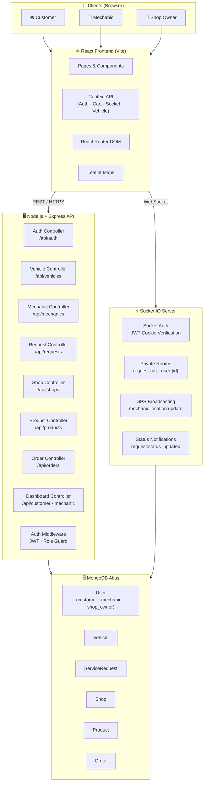
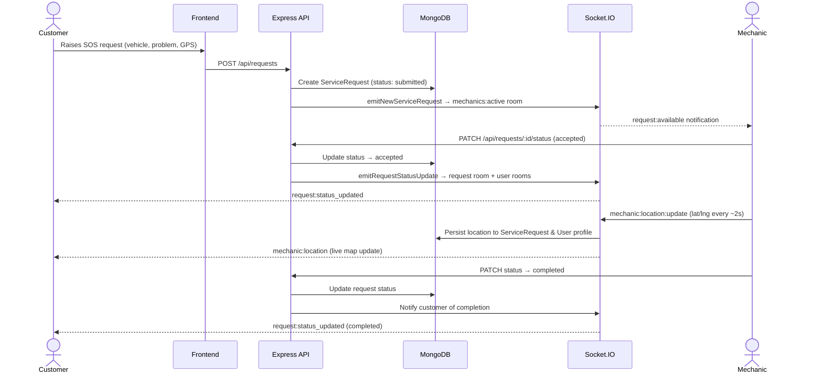
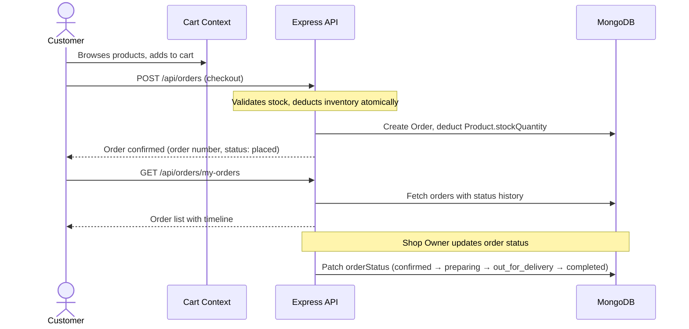
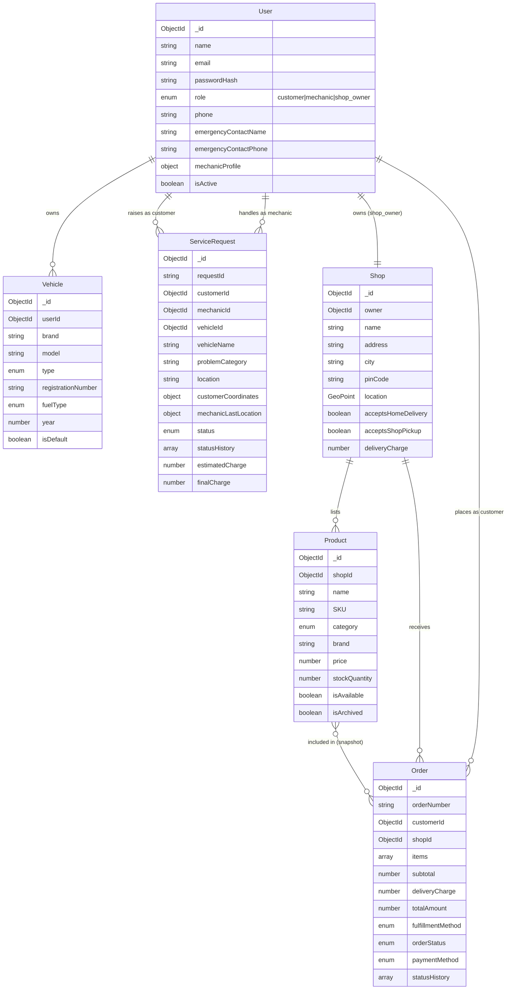

<div align="center">

# 🚗 RoadRescue

### Smart Emergency Roadside Assistance Platform

> **"When your vehicle stops, help shouldn't."**

[](https://nodejs.org)
[](https://react.dev)
[](https://www.mongodb.com/atlas)
[](https://socket.io)
[](https://expressjs.com)
[](https://vitejs.dev)

</div>

---

## 📋 Table of Contents

1. [Introduction](#-introduction)
2. [Project Overview](#-project-overview)
3. [Key Features](#-key-features)
4. [Technology Stack](#-technology-stack)
5. [System Architecture](#-system-architecture)
6. [Project Structure](#-project-structure)
7. [How the Application Works](#-how-the-application-works)
8. [Installation & Local Setup](#-installation--local-setup)
9. [Environment Variables](#-environment-variables)
10. [API Overview](#-api-overview)
11. [Database Design](#-database-design)
12. [Security Features](#-security-features)
13. [Testing](#-testing)
14. [Deployment](#-deployment)
15. [Current Limitations & Future Scope](#-current-limitations--future-scope)
16. [Project Information](#-project-information)
17. [Acknowledgements](#-acknowledgements)

---

## 🌟 Introduction

Vehicle breakdowns are unpredictable and stressful — a flat tyre on a highway, a dead battery in the rain, or an overheated engine far from the nearest workshop. Finding qualified help quickly is often the hardest part.

**RoadRescue** is a full-stack MERN web application that solves this problem by connecting:

- 🚘 **Stranded vehicle owners** who need immediate roadside assistance
- 🔧 **Mechanics and roadside service providers** who can respond to emergency requests in real time
- 🏪 **Spare-parts shop owners** who can receive online orders for home delivery or shop pickup

The platform uses geolocation, real-time GPS tracking via WebSockets, and a role-based multi-account system to deliver end-to-end roadside assistance and spare-parts procurement — all within a single unified web interface.

---

## 📖 Project Overview

RoadRescue is built as a three-sided marketplace with three distinct account types:

| Role | Purpose |
|------|---------|
| **Customer** | Registers their vehicles, raises emergency service requests, discovers nearby mechanics on a live map, tracks the assigned mechanic in real time, and orders spare parts for delivery or pickup |
| **Mechanic** | Receives incoming service requests, accepts or rejects jobs, shares live GPS coordinates so customers can track their arrival, and updates job status through each stage of the repair |
| **Shop Owner** | Registers their spare-parts shop, manages product inventory, fulfils customer orders via home delivery or shop pickup, and monitors sales through a dedicated dashboard |

The backend is a RESTful API server built with Node.js and Express, backed by MongoDB Atlas for persistent data storage and Socket.IO for real-time bidirectional communication. The frontend is a React SPA built with Vite, using React Router for navigation, Leaflet maps for geospatial features, and Context API for state management.

---

## ✨ Key Features

### 🚘 Customer Features

| Feature | Description |
|---------|-------------|
| **Account Registration & Login** | Secure customer registration and JWT cookie-based login |
| **Vehicle Management** | Add, edit, and delete multiple vehicles; set a default vehicle |
| **Emergency Assistance** | Raise SOS requests with vehicle details, problem category, and GPS location |
| **Mechanic Discovery** | Browse available mechanics filtered by distance, services, and availability |
| **Interactive Map** | View nearby mechanics on a live Leaflet map with real distance calculations |
| **Mechanic Profiles** | View mechanic profiles, workshop details, service offerings, and experience |
| **Request a Mechanic** | Direct request to a chosen mechanic for emergency dispatch |
| **Real-Time GPS Tracking** | Track the assigned mechanic's location live on a map as they travel to your location |
| **Spare-Parts Marketplace** | Browse products from registered shops, filter by category, search, and sort by price |
| **Shopping Cart** | Add products to cart, adjust quantities, and checkout |
| **Home Delivery** | Order parts to your registered delivery address |
| **Shop Pickup** | Choose in-store pickup at the shop's physical location |
| **Order History** | View all past and active orders with full status timelines |
| **Service History** | View all past emergency service requests |
| **Profile Management** | Update personal details, phone number, and emergency contact |

### 🔧 Mechanic Features

| Feature | Description |
|---------|-------------|
| **Mechanic Dashboard** | Overview of active jobs, pending requests, and account status |
| **Online / Offline Availability** | Toggle availability status to appear in customer searches |
| **Incoming Service Requests** | Receive real-time notifications of new emergency requests |
| **Accept / Reject Requests** | Accept a job or reject it (rejected requests can be reassigned) |
| **Active Job Management** | Update job status across defined stages: accepted → on the way → arrived → repair in progress → completed |
| **Live GPS Sharing** | Broadcast real-time GPS location to the customer's tracking view via Socket.IO |
| **Service Status Updates** | Mark request stages as work progresses |
| **Completed Job History** | Review past completed service requests |
| **Account Profile** | View and update workshop name, service area, services offered, and experience |

### 🏪 Shop Owner Features

| Feature | Description |
|---------|-------------|
| **Shop Registration** | Register a spare-parts shop with address, GPS coordinates, and fulfillment capabilities |
| **Shop Dashboard** | Overview of pending orders, revenue, and product statistics |
| **Product Management** | Add, edit, and archive products with name, SKU, category, brand, price, and description |
| **Inventory Management** | Track stock quantities; inventory is automatically deducted on order placement and restored on cancellation |
| **Order Management** | View all incoming orders and update their status |
| **Home Delivery Fulfilment** | Confirm, prepare, and dispatch home delivery orders |
| **Shop Pickup Fulfilment** | Mark orders as ready for pickup |
| **Sales Overview** | View aggregate revenue and order counts from the shop dashboard |

---

## 🛠️ Technology Stack

### Frontend

| Technology | Version | Purpose |
|------------|---------|---------|
| **React.js** | 18 | Component-based UI framework |
| **Vite** | 5 | Build tool and dev server |
| **JavaScript (ES2022+)** | — | Application language |
| **HTML5 / CSS3** | — | Markup and styling |
| **React Router DOM** | 6 | Client-side routing and navigation |
| **Leaflet** | 1.9 | Interactive map rendering |
| **React-Leaflet** | 4.2 | React bindings for Leaflet maps |
| **Socket.IO Client** | 4 | Real-time WebSocket client |
| **Lucide React** | 0.344 | Icon library |
| **Context API** | — | Global state management (Auth, Cart, Socket, Vehicle) |

### Backend

| Technology | Version | Purpose |
|------------|---------|---------|
| **Node.js** | 18+ | JavaScript runtime |
| **Express.js** | 5 | HTTP server framework |
| **REST API** | — | Stateless API architecture |
| **Socket.IO** | 4 | Real-time bidirectional communication |
| **Morgan** | 1 | HTTP request logging |
| **Helmet** | 8 | HTTP security headers |
| **CORS** | 2 | Cross-origin resource sharing |
| **express-rate-limit** | 8 | Brute-force protection for auth routes |

### Database

| Technology | Version | Purpose |
|------------|---------|---------|
| **MongoDB Atlas** | — | Cloud NoSQL database |
| **Mongoose** | 9 | ODM for schema validation and queries |

### Authentication & Security

| Technology | Purpose |
|------------|---------|
| **JWT (jsonwebtoken)** | Stateless authentication tokens |
| **Argon2id** | Password hashing (argon2 package) |
| **HttpOnly Cookies** | Secure token transport (inaccessible to JavaScript) |
| **Role-Based Authorization** | Route guards for `customer`, `mechanic`, and `shop_owner` roles |
| **Cookie Parser** | Server-side cookie reading middleware |

### Development Tools

| Tool | Purpose |
|------|---------|
| **Git / GitHub** | Version control and repository hosting |
| **VS Code** | Primary code editor |
| **Postman** | API testing and documentation |
| **Nodemon** | Auto-restart dev server on file changes |
| **ESLint** | Frontend code linting |
| **Antigravity** | AI-assisted development environment |

---

## 🏗️ System Architecture



---

## 📁 Project Structure

```
RoadRescue/
├── backend/                          # Node.js + Express API server
│   ├── src/
│   │   ├── app.js                    # Express app setup, middleware, route mounting
│   │   ├── server.js                 # HTTP server bootstrap, Socket.IO init, graceful shutdown
│   │   ├── config/
│   │   │   └── db.js                 # Mongoose connection
│   │   ├── controllers/
│   │   │   ├── authController.js     # Register, login, logout, profile, availability
│   │   │   ├── dashboardController.js# Customer and mechanic dashboard aggregation
│   │   │   ├── mechanicController.js # Mechanic directory, geospatial discovery, location
│   │   │   ├── orderController.js    # Order creation, status, shop stats
│   │   │   ├── productController.js  # Product CRUD, catalog
│   │   │   ├── requestController.js  # Emergency service requests lifecycle
│   │   │   ├── shopController.js     # Shop registration and profile
│   │   │   └── vehicleController.js  # Customer vehicle CRUD
│   │   ├── middleware/
│   │   │   ├── authMiddleware.js     # requireAuth, requireRole JWT guards
│   │   │   └── errorHandler.js       # Centralised error handler, 404 handler
│   │   ├── models/
│   │   │   ├── User.js               # User schema (customer · mechanic · shop_owner)
│   │   │   ├── Vehicle.js            # Vehicle schema
│   │   │   ├── ServiceRequest.js     # Emergency request schema + status history
│   │   │   ├── Shop.js               # Spare-parts shop schema (GeoJSON Point)
│   │   │   ├── Product.js            # Product schema (inventory, SKU, category)
│   │   │   └── Order.js              # Order schema (items snapshot, status lifecycle)
│   │   ├── routes/
│   │   │   ├── authRoutes.js         # /api/auth
│   │   │   ├── dashboardRoutes.js    # /api/customer/dashboard · /api/mechanic/dashboard
│   │   │   ├── healthRoutes.js       # /api/health (DB status check)
│   │   │   ├── mechanicRoutes.js     # /api/mechanics
│   │   │   ├── orderRoutes.js        # /api/orders
│   │   │   ├── productRoutes.js      # /api/products
│   │   │   ├── requestRoutes.js      # /api/requests
│   │   │   ├── shopRoutes.js         # /api/shops
│   │   │   └── vehicleRoutes.js      # /api/vehicles
│   │   ├── socket/
│   │   │   └── index.js              # Socket.IO server: auth, rooms, GPS, notifications
│   │   └── utils/
│   │       ├── jwt.js                # Token sign/verify helpers
│   │       ├── requestLookup.js      # Flexible ServiceRequest lookup (ObjectId or RR-XXXXX)
│   │       └── seed.js               # Optional database seeder (dev only)
│   ├── .env.example                  # Required backend environment variables (template)
│   ├── test-suite.js                 # Phase 2 auth integration tests
│   ├── test-phase3.js                # Phase 3 API tests
│   ├── test-workflow.js              # Phase 4 full workflow tests
│   ├── test-phase5-6.js              # Phase 5–6 geolocation & Socket.IO tests
│   └── package.json
│
├── frontend/                         # React SPA (Vite)
│   ├── public/
│   │   └── favicon.svg
│   ├── src/
│   │   ├── App.jsx                   # Root router and provider tree
│   │   ├── main.jsx                  # React DOM entry point
│   │   ├── components/
│   │   │   ├── common/               # Reusable UI: LogoutModal, ProtectedRoute, StatusBadge, StarRating
│   │   │   └── maps/                 # Leaflet map components: LiveTrackingMap, NearbyMechanicsMap
│   │   ├── context/
│   │   │   ├── AuthContext.jsx       # Authentication state, login/logout/register
│   │   │   ├── CartContext.jsx       # Shopping cart state and actions
│   │   │   ├── SocketContext.jsx     # Socket.IO connection lifecycle
│   │   │   └── VehicleContext.jsx    # Customer vehicle state
│   │   ├── hooks/
│   │   │   ├── useGeolocation.js     # Browser GPS hook
│   │   │   ├── useLiveTracking.js    # Socket tracking event listener hook
│   │   │   └── useMechanicLocation.js# Mechanic GPS broadcast hook
│   │   ├── layouts/
│   │   │   ├── DashboardLayout.jsx   # Customer dashboard layout (collapsible sidebar)
│   │   │   ├── MechanicDashboardLayout.jsx # Mechanic dashboard layout
│   │   │   └── ShopDashboardLayout.jsx     # Shop owner dashboard layout
│   │   ├── pages/
│   │   │   ├── LandingPage.jsx       # Public landing page
│   │   │   ├── LoginPage.jsx         # Login form
│   │   │   ├── RegisterPage.jsx      # Registration (customer · mechanic · shop owner)
│   │   │   ├── DashboardPage.jsx     # Customer dashboard
│   │   │   ├── MechanicDashboardPage.jsx   # Mechanic dashboard
│   │   │   ├── ShopDashboardPage.jsx # Shop owner dashboard
│   │   │   ├── ShopProductsPage.jsx  # Product management
│   │   │   ├── ShopOrdersPage.jsx    # Order management (shop owner)
│   │   │   ├── VehiclesPage.jsx      # Vehicle management
│   │   │   ├── EmergencyPage.jsx     # Emergency SOS request form
│   │   │   ├── MechanicsPage.jsx     # Mechanic discovery + map
│   │   │   ├── MechanicDetailPage.jsx# Individual mechanic profile
│   │   │   ├── RequestMechanicPage.jsx # Send a direct service request
│   │   │   ├── TrackingPage.jsx      # Real-time mechanic tracking map
│   │   │   ├── SparePartsPage.jsx    # Product marketplace / catalog
│   │   │   ├── CheckoutPage.jsx      # Cart checkout and order placement
│   │   │   ├── MyOrdersPage.jsx      # Customer order history
│   │   │   ├── OrderDetailPage.jsx   # Order detail view
│   │   │   ├── ProfilePage.jsx       # User profile settings
│   │   │   └── NotFoundPage.jsx      # 404 page
│   │   ├── styles/
│   │   │   └── global.css            # Global design system and CSS variables
│   │   └── utils/
│   │       ├── api.js                # Fetch wrapper, all API calls
│   │       ├── helpers.js            # Date formatting, currency, initials
│   │       └── storage.js            # localStorage key constants
│   ├── .env.example                  # Required frontend environment variables (template)
│   ├── vercel.json                   # Vercel SPA rewrite rule
│   ├── vite.config.js                # Vite config with dev proxy to backend
│   └── package.json
│
├── .gitignore                        # Ignores node_modules, .env, dist, backups
└── README.md                         # This file
```

---

## 🔄 How the Application Works

### Emergency Assistance Flow



### Spare-Parts Ordering Flow



---

## 🚀 Installation & Local Setup

### Prerequisites

- **Node.js** 18 or higher
- **npm** 9 or higher
- A **MongoDB Atlas** account (free tier is sufficient)
- **Git**

### 1. Clone the Repository

```bash
git clone https://github.com/Sharib-Ansari/RoadRescue.git
cd RoadRescue
```

### 2. Configure Environment Variables

```bash
# Backend
cp backend/.env.example backend/.env
# Edit backend/.env with your MongoDB URI, JWT secret, etc.

# Frontend
cp frontend/.env.example frontend/.env
# Edit frontend/.env with your backend URL (required only in production)
```

> **Important:** See the [Environment Variables](#-environment-variables) section for all required values.

### 3. Install and Start the Backend

Open **Terminal 1**:

```bash
cd backend
npm install
npm run dev
```

The backend server starts on `http://localhost:5000`.

### 4. Install and Start the Frontend

Open **Terminal 2**:

```bash
cd frontend
npm install
npm run dev
```

The frontend dev server starts on `http://localhost:5173`.

The Vite dev server automatically proxies all `/api` and `/socket.io` requests to the backend at `localhost:5000`, so no additional CORS configuration is needed in development.

---

## ⚙️ Environment Variables

### Backend — `backend/.env`

Create this file by copying `backend/.env.example`:

```ini
# Server
NODE_ENV=development
PORT=5000

# CORS — allow requests from the frontend origin
FRONTEND_URL=http://localhost:5173

# MongoDB Atlas connection string (primary database)
MONGODB_URI=mongodb+srv://<username>:<password>@<cluster>.mongodb.net/<database>?retryWrites=true&w=majority

# Dedicated test database URI (required to run any test script)
MONGODB_TEST_URI=mongodb+srv://<username>:<password>@<cluster>.mongodb.net/<test_database>?retryWrites=true&w=majority

# JWT Configuration
JWT_SECRET=<your_cryptographically_secure_secret_minimum_32_characters>
JWT_EXPIRES_IN=7d

# Cookie Configuration
COOKIE_EXPIRES_IN=7
COOKIE_SECURE=false       # Set to true in production (HTTPS only)
COOKIE_SAME_SITE=lax      # Set to none in production (cross-origin)
```

### Frontend — `frontend/.env`

In **local development**, the Vite proxy handles routing to the backend automatically. These variables are **required only in production**:

```ini
# Backend REST API base URL (required in production on Vercel)
VITE_API_URL=https://your-backend-api.onrender.com/api

# Backend Socket.IO server URL (required in production on Vercel)
VITE_SOCKET_URL=https://your-backend-api.onrender.com
```

> ⚠️ Never commit `.env` files. The root `.gitignore` already excludes them.

---

## 🔌 API Overview

All endpoints are prefixed with `/api`. All authenticated routes require a valid JWT `token` cookie.

### Authentication — `/api/auth`

| Method | Endpoint | Auth | Role | Description |
|--------|----------|------|------|-------------|
| `POST` | `/register` | No | — | Register customer, mechanic, or shop owner |
| `POST` | `/login` | No | — | Login (rate-limited: 10 req / 15 min per IP) |
| `GET` | `/me` | ✅ | Any | Get current authenticated user |
| `PATCH` | `/profile` | ✅ | Any | Update profile details |
| `PATCH` | `/availability` | ✅ | Mechanic | Toggle mechanic availability |
| `POST` | `/logout` | ✅ | Any | Clear JWT cookie and logout |

### Vehicles — `/api/vehicles`

| Method | Endpoint | Auth | Description |
|--------|----------|------|-------------|
| `GET` | `/` | ✅ | List user's vehicles |
| `POST` | `/` | ✅ | Add a new vehicle |
| `PUT` | `/:id` | ✅ | Update vehicle details |
| `DELETE` | `/:id` | ✅ | Remove a vehicle |

### Mechanics — `/api/mechanics`

| Method | Endpoint | Auth | Role | Description |
|--------|----------|------|------|-------------|
| `GET` | `/` | No | — | Public mechanic directory |
| `GET` | `/nearby` | ✅ | Any | Geospatial mechanic discovery (by lat/lng/radius) |
| `GET` | `/dashboard/stats` | ✅ | Mechanic | Mechanic dashboard statistics |
| `PATCH` | `/location` | ✅ | Mechanic | Update mechanic GPS location |
| `GET` | `/:id` | No | — | Public mechanic profile by ID |

### Emergency Requests — `/api/requests`

| Method | Endpoint | Auth | Description |
|--------|----------|------|-------------|
| `POST` | `/` | ✅ | Create a new emergency service request |
| `GET` | `/` | ✅ | List current user's service requests |
| `GET` | `/active` | ✅ | Get the active (in-progress) request |
| `GET` | `/:id` | ✅ | Get request details by ID |
| `PATCH` | `/:id/status` | ✅ | Update request status (accept, complete, cancel, etc.) |
| `PATCH` | `/:id/reassign` | ✅ | Reassign a rejected request to another mechanic |

### Shops — `/api/shops`

| Method | Endpoint | Auth | Role | Description |
|--------|----------|------|------|-------------|
| `POST` | `/` | ✅ | Shop Owner | Register a new shop |
| `GET` | `/me` | ✅ | Shop Owner | Get own shop profile |
| `PATCH` | `/me` | ✅ | Shop Owner | Update shop details |
| `GET` | `/` | No | — | Public shop directory |
| `GET` | `/:id` | No | — | Public shop details |

### Products — `/api/products`

| Method | Endpoint | Auth | Role | Description |
|--------|----------|------|------|-------------|
| `POST` | `/` | ✅ | Shop Owner | Create a new product |
| `GET` | `/my-products` | ✅ | Shop Owner | List owner's products |
| `PUT` | `/:id` | ✅ | Shop Owner | Update product details or stock |
| `DELETE` | `/:id` | ✅ | Shop Owner | Archive a product (preserves order history) |
| `GET` | `/` | No | — | Public product catalog |
| `GET` | `/:id` | No | — | Product details |

### Orders — `/api/orders`

| Method | Endpoint | Auth | Role | Description |
|--------|----------|------|------|-------------|
| `POST` | `/` | ✅ | Customer | Place an order (deducts inventory) |
| `GET` | `/my-orders` | ✅ | Customer | Customer order history |
| `GET` | `/shop-orders` | ✅ | Shop Owner | Incoming orders for the shop |
| `GET` | `/shop-stats` | ✅ | Shop Owner | Shop revenue and order count statistics |
| `PATCH` | `/:id/status` | ✅ | Any | Update order status |
| `GET` | `/:id` | ✅ | Any | Order detail view |

### Dashboards — `/api`

| Method | Endpoint | Auth | Role | Description |
|--------|----------|------|------|-------------|
| `GET` | `/customer/dashboard` | ✅ | Customer | Aggregated customer statistics |
| `GET` | `/mechanic/dashboard` | ✅ | Mechanic | Mechanic account and job summary |

### Health — `/api/health`

| Method | Endpoint | Auth | Description |
|--------|----------|------|-------------|
| `GET` | `/` | No | Returns `200 OK` (DB connected) or `503` (DB disconnected) |

### Real-Time Socket.IO Events

| Event (Client → Server) | Description |
|--------------------------|-------------|
| `join:request` | Join a private tracking room for a specific service request |
| `leave:request` | Leave a tracking room |
| `mechanic:location:update` | Mechanic broadcasts their GPS coordinates (rate-limited: 1.5 s) |

| Event (Server → Client) | Description |
|--------------------------|-------------|
| `request:available` | New emergency request notification dispatched to mechanics |
| `request:status_updated` | Service request status changed notification |
| `mechanic:location` | Live mechanic GPS coordinates for customer's tracking map |

---

## 🗄️ Database Design

### Models Overview



### Model Descriptions

| Model | Collection | Description |
|-------|-----------|-------------|
| **User** | `users` | Unified user document supporting three roles. Mechanics embed a `mechanicProfile` subdocument (workshop, GPS location, services). Password hashed with Argon2id, never returned in queries (`select: false`). |
| **Vehicle** | `vehicles` | Vehicles registered by customers. Each vehicle belongs to one user via `userId`. |
| **ServiceRequest** | `servicerequests` | Emergency assistance requests. Tracks the full lifecycle from `submitted` → `accepted` → `on_the_way` → `arrived` → `repair_in_progress` → `completed` / `cancelled`. Stores customer GPS coordinates, mechanic's last known location, and a full status history. |
| **Shop** | `shops` | Spare-parts shop profile. One shop per `shop_owner` user (enforced by unique index on `owner`). Stores GeoJSON Point location for future geospatial shop discovery. |
| **Product** | `products` | Spare-parts inventory. SKU is unique within each shop (compound index). Products are archived rather than deleted to preserve historical order data. |
| **Order** | `orders` | Customer purchase orders. Stores a price and name snapshot of each ordered item so historical orders remain accurate if product details change later. Supports `home_delivery` and `shop_pickup` fulfilment. |

---

## 🔐 Security Features

| Feature | Implementation |
|---------|---------------|
| **Password Hashing** | Argon2id with 64 MB memory cost, 3 time cost, 1 parallelism — industry-recommended configuration |
| **JWT Authentication** | Signed with `HS256` via `jsonwebtoken`; expiry configurable via `JWT_EXPIRES_IN` |
| **HttpOnly Cookie Transport** | JWT token is stored exclusively in an `HttpOnly` cookie — inaccessible to JavaScript, preventing XSS token theft |
| **Role-Based Authorization** | Every protected route checks `requireAuth` (valid JWT) and optionally `requireRole('mechanic' | 'shop_owner' | 'customer')` |
| **Shop Ownership Validation** | Product and order management endpoints verify that the authenticated user owns the referenced shop |
| **Brute-Force Protection** | Login endpoint rate-limited to 10 attempts per 15-minute window per IP via `express-rate-limit` |
| **Security Headers** | `helmet` middleware sets `X-Content-Type-Options`, `X-Frame-Options`, `Strict-Transport-Security`, and other security headers |
| **Private Socket.IO Rooms** | Each service request has a private room (`request:<id>`). Only the customer who raised the request and the assigned mechanic are authorized to join |
| **Socket Authentication** | Socket.IO server verifies the JWT cookie on every connection handshake before allowing room access |
| **CORS Restriction** | CORS allows requests only from the configured `FRONTEND_URL` with `credentials: true` |
| **Reverse Proxy Trust** | `app.set('trust proxy', 1)` ensures accurate IP detection for rate limiting behind Render's load balancer |

---

## 🧪 Testing

The project includes integration test suites for each development phase. All test scripts that mutate data **require a dedicated test database URI** and will refuse to run without it.

### Available Commands

```bash
# Phase 2 — Authentication & user management
cd backend
MONGODB_TEST_URI=<your_test_uri> npm test

# Phase 4 — Full request workflow integration
cd backend
MONGODB_TEST_URI=<your_test_uri> npm run test:workflow

# Phase 5–6 — Geolocation and real-time tracking
cd backend
MONGODB_TEST_URI=<your_test_uri> npm run test:phase5
```

> ⚠️ **Safety**: All test scripts verify that `MONGODB_TEST_URI` is set and abort immediately if it is missing. This prevents accidental mutation of your production database. Never point `MONGODB_TEST_URI` at your primary cluster.

---

## 🌐 Deployment

RoadRescue is designed to deploy to the following cloud stack:

| Component | Platform | Status |
|-----------|----------|--------|
| Frontend (React + Vite) | **Vercel** | Planned |
| Backend (Node.js + Express + Socket.IO) | **Render** | Planned |
| Database | **MongoDB Atlas** | Active (development) |

> **Note:** The application has not yet been deployed to production. No live URLs exist at this time.

### Vercel (Frontend)

1. Connect the repository to Vercel.
2. Set **Root Directory** to `frontend`.
3. Set **Build Command** to `npm run build` and **Output Directory** to `dist`.
4. Add environment variables: `VITE_API_URL` and `VITE_SOCKET_URL`.
5. The `frontend/vercel.json` SPA rewrite rule is already in place for React Router compatibility.

### Render (Backend)

1. Create a new **Web Service** on Render.
2. Set **Root Directory** to `backend`, **Build Command** to `npm install`, **Start Command** to `npm start`.
3. Add all environment variables from `backend/.env.example`.
4. Set `COOKIE_SECURE=true` and `COOKIE_SAME_SITE=none` for cross-origin cookie authentication.
5. Verify deployment using `GET /api/health`.

---

## 🔭 Current Limitations & Future Scope

### Known Limitations

| Area | Current State |
|------|--------------|
| **Payments** | Orders are placed as "Cash on Delivery" or "Pay at Shop". Online payment gateway (e.g. Razorpay) is not yet integrated |
| **Notifications** | No email or SMS notifications are sent on request status changes |
| **Image Storage** | Products do not currently support uploaded images. Only a URL string field exists |
| **Mobile App** | No dedicated iOS or Android application. Web application is usable on mobile browsers |
| **Map Tiles** | Leaflet uses OpenStreetMap tile servers suitable for development. A commercial tile provider is recommended for production scale |
| **Reviews** | The database schema supports service request ratings, but a review submission UI for completed jobs is not yet built |
| **Mechanic Live Stats** | The mechanic dashboard shows structural data. Detailed earnings calculations are a planned enhancement |

### Future Scope

- 💳 **Online payments** via Razorpay or Stripe
- 📧 **Email and SMS notifications** on request and order events
- 📱 **Progressive Web App (PWA)** support for mobile installation
- ⭐ **Review and rating system** for mechanics post-service
- 📊 **Advanced analytics** for shop owners (revenue trends, top products)
- 🗺️ **Geospatial shop discovery** (find nearest shops by distance)
- 🔔 **Push notifications** via Web Push API
- 🖼️ **Cloud image storage** for product photos via Cloudinary or AWS S3

---

## 👤 Project Information

| Field | Detail |
|-------|--------|
| **Project Title** | RoadRescue — Smart Emergency Roadside Assistance Platform |
| **Developer** | Sharib Ansari |
| **Roll Number** | 253043001 |
| **Program** | Master of Computer Applications (MCA) |
| **GitHub Repository** | [github.com/Sharib-Ansari/RoadRescue](https://github.com/Sharib-Ansari/RoadRescue) |

---

## 🙏 Acknowledgements

This project was built using the following open-source technologies and services. Gratitude to their maintainers and communities:

- [**React**](https://react.dev) — Meta Open Source
- [**Vite**](https://vitejs.dev) — Evan You and contributors
- [**Express.js**](https://expressjs.com) — TJ Holowaychuk and the Node.js community
- [**Socket.IO**](https://socket.io) — Guillermo Rauch and contributors
- [**MongoDB**](https://www.mongodb.com) and [**Mongoose**](https://mongoosejs.com)
- [**Leaflet**](https://leafletjs.com) and [**React-Leaflet**](https://react-leaflet.js.org)
- [**argon2**](https://github.com/ranisalt/node-argon2) — Ranieri de Souza Pinto
- [**jsonwebtoken**](https://github.com/auth0/node-jsonwebtoken) — Auth0
- [**Lucide React**](https://lucide.dev) — Lucide Contributors
- [**Helmet**](https://helmetjs.github.io) — Adam Baldwin
- [**OpenStreetMap**](https://www.openstreetmap.org) — Map tile data contributors

> *RoadRescue is an independent academic project. Use of the above technologies does not imply endorsement or affiliation with any third-party organization.*

---

<div align="center">

**Built with dedication by Sharib Ansari.**

*"When your vehicle stops, help shouldn't."*

---

© 2026 Sharib Ansari. All rights reserved. This project is not licensed for redistribution.

</div>
